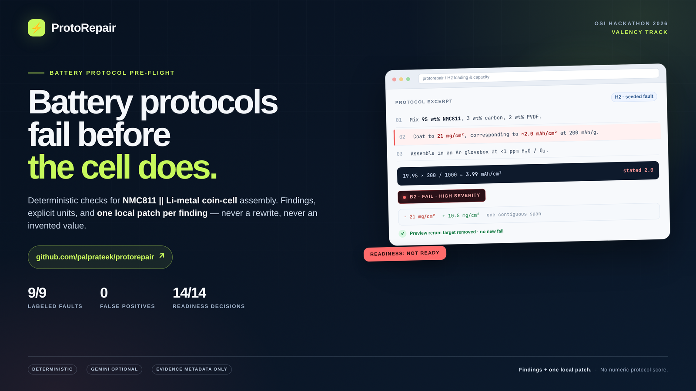
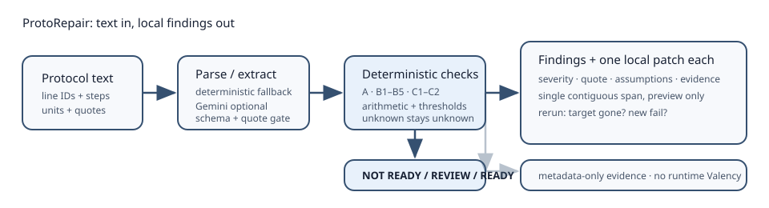

# ProtoRepair: a pre-flight checker for NMC811 || Li-metal coin cells

**One-line pitch:** Paste an assembly protocol; get deterministic findings and one local patch per finding, with explicit units, assumptions, and metadata-only evidence — not a rewritten protocol or a made-up score.

## The problem

Coin-cell protocols fail silently in the space between prose and arithmetic. A cathode line says 95:3:2, while a later sentence says 90:5:5. A loading of 21 mg/cm² is paired with an areal capacity that implies 3.99 mAh/cm², not the stated 2.0. A 20 µL fill looks fine until divided by the cathode capacity. A Li-metal protocol says “N₂ glovebox.” An LLM can read all of this and still invent a confident correction.

ProtoRepair is deliberately narrower: it checks what can be checked deterministically, keeps missing values visible, and proposes a local patch only when the source gives a defensible target.

## What the user sees

- **Readiness:** `NOT READY`, `REVIEW`, or `READY` — no numeric protocol score.
- **Findings:** class, step, quote, severity, confidence, explanation, assumptions, evidence.
- **One patch per finding:** a single contiguous span, preview only, never merged.
- **Moisture budget:** per-cell water mass, CAM-basis ppm, HF upper bound, component limits; the 430 ppm line is labeled as a Gr/NMC622 warning, not an NMC811 constant.
- **Unknowns:** missing Li thickness, electrolyte volume, water values, or drying time stay `unknown`; they are not converted to zero or a pass.

**Tutorial:** [watch the 3:12 walkthrough](docs/assets/protorepair-tutorial.mp4) · **Gallery card:** [1200×1200](docs/assets/protorepair-gallery-card.png)

## How it works

1. **Parse conservatively.** Line IDs, step segmentation, units, and quotes. The licensed demo fixtures carry structured facts; pasted text falls back to a deterministic parser.
2. **Extract only if needed.** Optional Gemini extraction must pass the frozen JSON Schema, quote/line checks, and unit/basis reconciliation. Invalid output is discarded. No key still runs.
3. **Run deterministic checks.** Composition, loading ↔ capacity, Li excess, electrolyte fill, salt molarity, moisture, atmosphere/drying, units, and semantics. Arithmetic and thresholds live in code, not in the model.
4. **Propose local patches.** Apply the text/structured patch to the original, rerun all checks, require the target finding to disappear, and count any new fail as a regression.
5. **Attach metadata-only evidence.** Runtime never calls Valency. `EVIDENCE_MODE=none` is a clean no-Valency ablation.

## Demo narrative (90 seconds)

1. Load **G14**, the P2-derived clean control: `READY`, no patches; the moisture table shows the worked 745 ppm CAM-basis / 101 ppm HF upper-bound calculation.
2. Load **G02**, the source-faithful P2 base: `REVIEW`; B1 solids, B3 Li thickness, C1 water, and C2 CAM drying are visibly unknown.
3. Step through **H1–H4**: composition/prose mismatch, 21 vs 10.5 mg/cm², 20 vs 200 µL, and N₂ vs Ar. Each shows exactly one seeded fail and one patch.
4. Load the **composite H1+H3+H4**: three independent findings and three patches; patching one does not pretend to fix the others.
5. Load **G07** (P4 natural): “5.0 wt% NMP” and “3 mAh g−1” are ambiguity findings, not confident corrections.
6. Toggle `EVIDENCE_MODE=none`: findings stay the same; citation metadata disappears.

## Evaluation

Small descriptive case study, not a benchmark. 14 frozen cases: 9 fail labels, 2 ambiguous labels, 2 fully specified clean controls, and 5 no-fault/unknown cases. No cells were assembled; labels were not blind-adjudicated.

| System | TP | FP | FN | Clean value patches | Patch validity | Readiness |
|---|---:|---:|---:|---:|---:|---:|
| ProtoRepair full | 9 | 0 | 0 | 0 | 9/9 | 14/14 |
| B2 deterministic-only | 9 | 0 | 0 | 0 | 9/9 | 14/14 |
| B4 no-Valency | 9 | 0 | 0 | 0 | 9/9 | 14/14 (citation coverage 0) |
| B3 archived linter | 0 | 0 | 7 | — | — | not comparable |
| B0 raw LLM | not run | — | — | — | — | — |

The perfect counts reflect a deliberately small, fixture-driven demo set and a checker built alongside its labels. They are not evidence of general accuracy. B0 is marked `not_run`, not estimated. The archived generic linter has no B1–B5/C1–C2 crosswalk, so its result is a baseline limitation.

Public-only rerun: 11 cases, 7 TP / 0 FP / 0 FN, 7/7 patch validity, 11/11 readiness.

### Live Gemini extraction (optional path)

A repeatable live run on the 11 public cases, with `gemini-3.5-flash-lite` and no cache, produced:

| Metric | Result |
|---|---:|
| Schema/quote-valid responses | 11/11 |
| Labeled faults matched | 7/7 |
| False positives / false negatives | 0 / 0 |
| Readiness exact | 11/11 |
| Patch validity | 7/7 |
| Latency mean / median / p95 / max | 9.08 / 9.43 / 10.61 / 12.27 s |

This is an extraction-path test, not the B0 raw-LLM baseline. Gemini only extracts stated facts; deterministic checks, units, patches, and readiness remain code-owned. The harness is `eval/protorepair/run_gemini_live.py`; saved results are in `eval/protorepair/gemini_live_results.md`. `GEMINI_MODEL` overrides the default model.

## Why this fits the Valency track

The evidence layer is build-time and public-safe: metadata only, no abstracts, no raw MCP output, no runtime token. The product uses retrieved provenance to make findings traceable while keeping the numeric checks deterministic. **Evidence retrieval powered by Valency MCP Bond.**

## Limits and safety

- NMC811 || Li-metal only; assembly excerpt in, findings out.
- No PDF/OCR, no multi-protocol batch, no database, no numeric score.
- No claim that a patch is experimentally validated or expert-approved.
- NMP, Li metal, HF, and coin-cell assembly are hazardous; PI/EHS review remains required.
- Three local-only source-derived fixtures are excluded from the public repo. Never publish `.env` or API keys; rotate any key that may have been exposed.

## Links

- Code: [github.com/palprateek/protorepair](https://github.com/palprateek/protorepair).
- Demo video: [3:12 narrated walkthrough](docs/assets/protorepair-tutorial.mp4).
- Cover: [1600×900](docs/assets/protorepair-cover.png) · Gallery card: [1200×1200](docs/assets/protorepair-gallery-card.png).
- Licenses: MIT for code; CC BY 4.0 for docs; third-party fixture notices in `THIRD_PARTY.md`.
